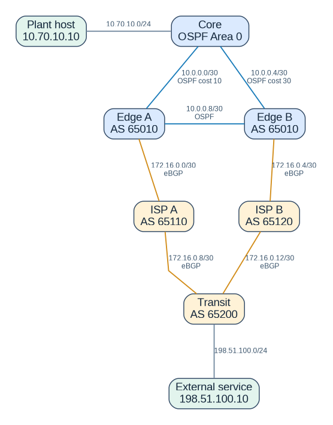

# Industrial Routing Lab: OSPF + BGP

A reproducible routing lab simulating a small industrial network with two independent WAN paths. The focus is on OSPF and eBGP adjacencies, controlled route advertisements, deterministic path selection, and recovery from a primary uplink failure.



**Stack:** Containerlab 0.82.0, FRRouting 10.7.1, Alpine Linux, Docker. Router configurations are stored under `configs/`.

## Architecture and objectives

- OSPF Area 0 between Core, Edge A, and Edge B
- Two independent eBGP uplinks to simulated ISPs and a transit AS (no real Internet access)
- Explicit prefix lists controlling inbound and outbound advertisements
- Conditional ISP default-route advertisement when the external service prefix is available
- OSPF external type-1 default-route origination on the edge routers only when a default route is available
- Primary and backup path selection using OSPF cost and BGP local preference
- WAN failover test: disable Edge A's ISP uplink, inspect the backup path, and restore the original link

See [network addressing](docs/addressing.md) and [design decisions](docs/design.md) for details.

## Prerequisites

- Linux, or Windows 10/11 with Containerlab-WSL, Docker, and Containerlab
- Permission to run Containerlab and access the Docker engine
- Enough free memory to run eight containers
- Internet access for the initial image downloads
- Optional: Python 3 + PyYAML for static tests, Graphviz to regenerate the topology diagram

**Observed environment:** Windows 10 Build 19045.6466, Containerlab-WSL 0.82.0, Docker 27.5.1. All eight containers started successfully on November 6, 2026. Container startup alone does not prove working routing.

## Quick start

```bash
# Run from the repository root
sudo containerlab deploy -t topology.clab.yml

# Load the integrated FRR configuration after the daemons become ready.
bash scripts/bootstrap.sh

# Verify OSPF/BGP and reachability before testing failures.
bash scripts/verify.sh

# Disable and restore the primary ISP uplink in this isolated lab.
bash scripts/failover.sh

# Tear down the lab when finished.
sudo containerlab destroy -t topology.clab.yml --cleanup
```

Alternatively, run `make deploy` to deploy and bootstrap, `make verify` to check connectivity, and `make failover` to test recovery.

**Important:** The scripts expect Docker access without `sudo`; adapt permissions to your environment. Run this lab only in an isolated test environment, never on production routers.

## Manual verification

```bash
docker exec clab-industrial-routing-core vtysh -c 'show ip ospf neighbor'
docker exec clab-industrial-routing-core vtysh -c 'show ip route 0.0.0.0/0'
docker exec clab-industrial-routing-edge-a vtysh -c 'show bgp ipv4 unicast summary'
docker exec clab-industrial-routing-transit vtysh -c 'show bgp ipv4 unicast 10.70.10.0/24'
docker exec clab-industrial-routing-plant ping -c 3 198.51.100.10
```

## Repository structure

```text
.
├── topology.clab.yml          # Router and client nodes, links, and interfaces
├── configs/                   # FRRouting configurations for six routers
├── scripts/                   # FRR bootstrap, verification, and WAN failover
├── tests/                     # Static topology and configuration checks
├── docs/
│   ├── topology.png           # Network diagram
│   ├── addressing.md          # IP addressing and AS numbers
│   ├── design.md              # Routing rationale and limitations
│   ├── troubleshooting.md     # Diagnostic commands
│   └── test-log.md            # Actual observations and test status
└── .github/workflows/         # Static and live routing CI workflows
```

## Route-policy rationale

The edge routers do **not** redistribute the entire OSPF domain into BGP. They advertise only `10.70.10.0/24` toward the ISPs and accept only `0.0.0.0/0` from them. This avoids unintended prefix leaks and keeps the core routing table focused on internal routes and a default route.

The transit AS uses BGP local preference to favor the return path through ISP A. Outbound path selection within the plant is based on OSPF metrics. These are separate routing decisions.

## Verified results

**Automated live validation passed on November 6, 2026**, on a GitHub-hosted Ubuntu runner. The [successful live workflow run](https://github.com/ModarRostom/industrial-ospf-bgp-lab/actions/runs/42273117707) demonstrates:

- OSPF: both core adjacencies reached the `Full` state.
- OSPF: the core installed its default route via Edge A.
- BGP: the transit router installed the production prefix `10.70.10.0/24`.
- Reachability: ICMP succeeded from Plant to Service and from Service to Plant.
- WAN failover: after disabling `edge-a:eth3`, the core selected Edge B, and Plant-to-Service connectivity remained available (3/3 ping replies).
- Recovery: after restoring `edge-a:eth3`, the core selected the preferred path via Edge A again.

**Static configuration checks also passed:** [successful static workflow run](https://github.com/ModarRostom/industrial-ospf-bgp-lab/actions/runs/42273117662).

**Local environment:** a separate deployment on Windows 10 / Containerlab-WSL reported all eight containers running. The complete live verification and failover results above were measured in GitHub Actions on Linux, **not** on the user's Windows/WSL machine. No production-grade reliability, SLA, or guaranteed convergence time is claimed.

For commands, observed results, and limitations, see the [test log](docs/test-log.md).

## References

- [Containerlab: FRRouting kind](https://containerlab.dev/manual/kinds/frr/)
- [FRRouting: OSPF](https://docs.frrouting.org/en/stable-10.7/ospfd.html)
- [FRRouting: BGP](https://docs.frrouting.org/en/stable-10.7/bgp.html)

*Educational demonstration in an isolated simulated environment. No real industrial control equipment or live Internet connectivity is used.*
